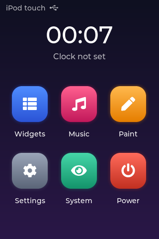

# n72-ui

A touch launcher for Linux on the iPod touch 2G (N72AP), built on
[LVGL](https://lvgl.io) 9.2.2 with its Linux framebuffer and evdev drivers.

- Home screen with a clock and six apps: LVGL's Widgets and Music demos,
  Paint (finger drawing), Settings (brightness), System (live stats) and Power.

- Buttons: Home returns to the launcher (the demos restart the process),
  Power turns the backlight off and on, the volume keys change the brightness.

## Gestures and animations (frame rates measured on the device)

| What | How it is drawn | fps |
| --- | --- | --- |
| Quick settings follow the finger on home (open / close) | pictures of home and the shade moved by the GPU; home and scrim drawn only below the shade | 53-61 |
| ... over an application | the shade's picture moved by the CPU (alpha); the dim is added once it settles | 61-69 |
| App opens: a card in the tile's colour grows from the icon, then clears to show the application | home picture + rounded GPU fill; then one translucent GPU fill | 57-58 |
| App closes (Home or its own exit): the card comes up, goes into the icon | one translucent GPU fill; then home picture + rounded GPU fill | 58-61 |
| A page from its tile (Settings, Paint): the same card, over pictures of the page and of home | as above; the page is built once the card covers the screen (one frame of ~65 ms) | 56 open, 59 close |
| Lock screen swipe up (home or over an application) | the lock screen's picture follows the finger, a scrim fades | ~63 |

- The card moves like a spring, not along a timed curve (`za_path_spring`,
  `za_path_glide` in `ui_m3.c`). Opening: critically damped, 380 ms, from
  rest, fastest after ~55 ms, 90 % of the way by ~210 ms, then a soft
  landing; the symbol dissolves on the way, the corners (20 px at the icon,
  26 px half way) square off towards the screen's, and the card clears in
  180 ms as soon as it has landed (no hold; the application has as long to
  start as before). Closing is shorter: the card comes up in 100 ms and
  goes in 280 ms, starting gently (no speed in the first frame, fastest
  after ~60 ms), and melts into home's icon at the end. A frame costs what
  it did: the same picture and fill, smaller corners, the symbol for less
  of the way.
- These rates need the display's vblank: when a burst in the `N72_FPS` log
  shows `vblank wait` near 48 ms a frame, the kernel's frame interrupt is
  not coming and every flip waits for its 20 Hz fallback beat (~22 fps,
  whatever is drawn).
- The touch router (`main.c`) offers each launcher touch to `ui_drag()`; a
  vertical drag past 12 px where the shade (or the lock screen) can move is
  taken from LVGL, which loses the press without a click. The release
  settles by position and speed.
- The lock screen goes up whenever the screen goes off; its clock is
  Montserrat SemiBold at 88 px through LVGL's tiny_ttf (`clock_font.h`, SIL
  Open Font License 1.1, from LVGL's demos).
- Manifests may set `icon=` (video, image, music, gears, file, list, ...) and
  `color=#rrggbb` for the tile.
- `N72_FPS=1` logs every burst of frames and the animation phases.
- `N72_TRACE=1` (with `N72_FPS=1`) logs, for every frame that came more than
  20 ms after the one before, what the main loop did in between (timers,
  input, layout, drawing, flush) and the GPU's share.

## GPU

When `/dev/mbx` exists (the PowerVR MBX Lite driver in the n72 kernel), n72-ui
draws through the GPU's 2D engine (`mbx_gpu.c`):

- every LVGL draw buffer comes from one GPU-mapped, CPU-cached pool;
- large plain fills (no radius, no gradient) run on the GPU: opaque ones on
  the 2D engine, translucent ones on the 3D core;
- opacity layers are composited by the 3D core;
- the display renders into a full-screen pool buffer and the GPU copies the
  refreshed areas to the framebuffer.

`n72-ui --bench` times full-screen redraws; `N72_GPU=0` forces the CPU path.

Translucent plain fills are blended by the GPU's 3D core, and opacity layers
(`opa_layered`) are composited by it as textured copies (exact two-pass
blending below full opacity). GPU and CPU frames agree to within 2 per colour
channel.

| Scene (full redraw) | CPU | GPU |
| --- | --- | --- |
| Home screen | 35.0 ms | 24.1 ms |
| 24 plain rectangles | 12.8 ms | 9.9 ms |
| + translucent panels and a 70% opacity layer | 34.5 ms | 28.6 ms |

## Responsiveness

The main loop sleeps in `poll()` on the touch screen and buttons, hands touch
input to LVGL as soon as it arrives and renders the result straight away;
LVGL's own timers run at 16 ms. With the kernel's fast touch reads (zephyr2
at 4.5 MHz, ~0.2 ms per frame) touch reports arrive at ~60 Hz instead of ~42.

## Build

LVGL goes in `../lvgl-src/lvgl` (`git clone -b v9.2.2 https://github.com/lvgl/lvgl`).
From the workspace root, on the Mac (the cross gcc of
`n72-alpine/toolchain`, see its README; `N72_CC=clang` for clang, the build
`pgo/n72ui.profdata` applies to, into `../n72-ui-build-clang/`):

    sh n72-ui/build.sh

The static binary lands in `../n72-ui-build/n72-ui`;
`linux-s5l87xx/freemyipod/build-initramfs-n72.sh` installs it and starts it at
boot (add `noui` to the kernel command line to skip it).

## Environment

| Variable | Meaning |
| --- | --- |
| `N72_FB` | Framebuffer (default `/dev/fb0`) |
| `N72_TOUCH` / `N72_KEYS` | Event devices (default: found by name) |
| `N72_TOUCH_CAL` | `min_x min_y max_x max_y` raw touch range; swap a pair to flip an axis |
| `N72_TOUCH_SWAP` | `1` swaps the touch axes |
| `N72_GPU` | `0` draws with the CPU only (default: GPU when `/dev/mbx` exists) |
| `N72_LATENCY` | `1` logs touch-to-screen latency every 2 s (stderr) |
| `TZ` | Clock time zone (the initramfs sets it from `/etc/TZ`) |

## Kernel

Runs on the n72 branch of [kailashrs/linux](https://github.com/kailashrs/linux/tree/n72)
(simplefb display, Zephyr2 touchscreen, gpio-keys).

## License

MIT (see `LICENSE`). LVGL is MIT-licensed as well.
